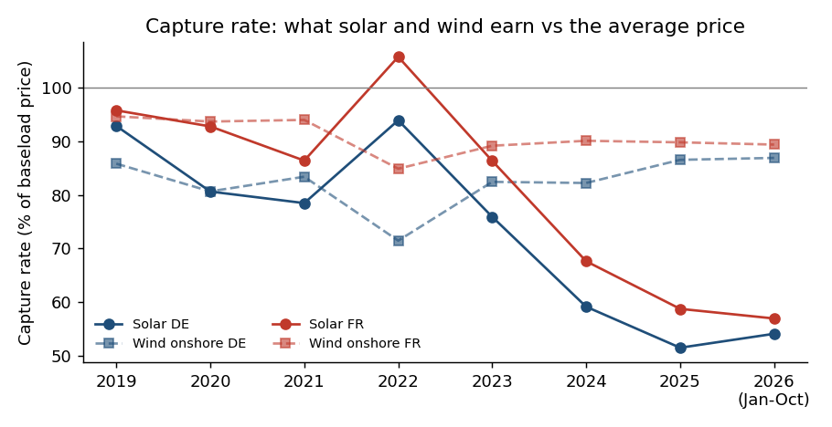
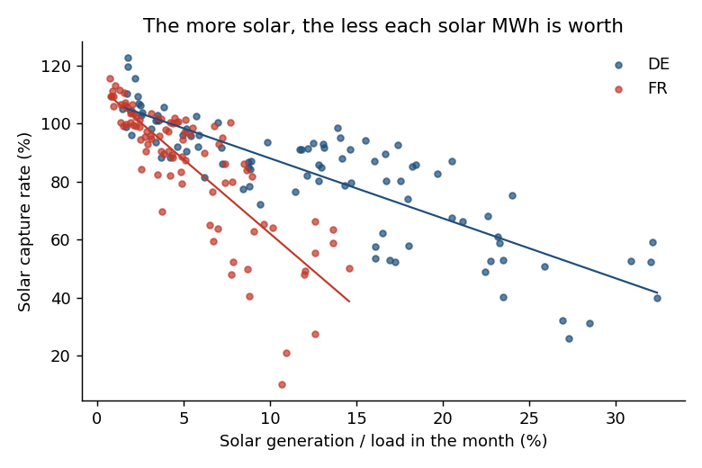
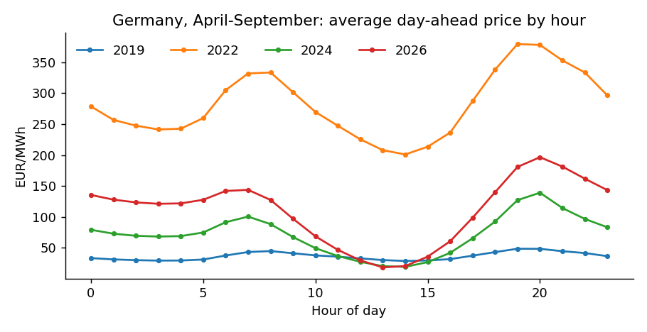
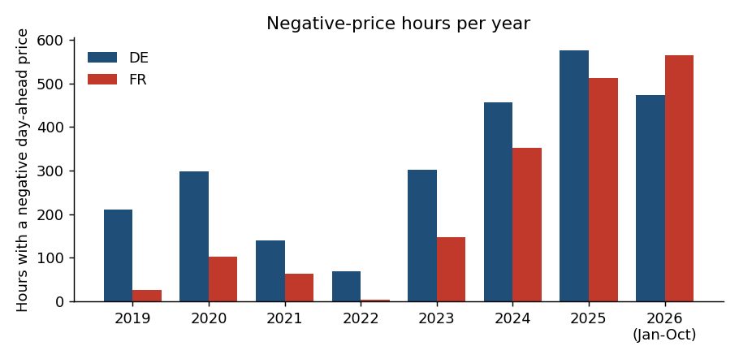

# Solar & wind capture prices in Germany and France (2019–2026)

How much is a MWh of solar or wind actually worth on the day-ahead market, and how fast is that value falling as more renewables are built?

This project downloads hourly day-ahead prices and generation by source for **Germany-Luxembourg** and **France**, and computes for each year:

- the **baseload price** (simple average of all hourly prices),
- the **capture price** of solar, onshore wind and offshore wind (generation-weighted average price),
- the **capture rate** = capture price / baseload price,
- the number of **negative-price hours**,
- the **cannibalisation** relationship: monthly solar capture rate vs solar share of load.

## Key results



| | 2019 | 2022 | 2024 | 2025 | 2026 (Jan–Oct) |
|---|---|---|---|---|---|
| DE baseload (EUR/MWh) | 37.7 | 235.4 | 78.5 | 89.3 | 114.5 |
| DE solar capture rate | 93% | 94% | 59% | 52% | 54% |
| DE wind onshore capture rate | 86% | 72% | 82% | 87% | 87% |
| FR solar capture rate | 96% | 106% | 68% | 59% | 57% |
| DE negative-price hours | 211 | 69 | 457 | 576 | 474 |
| FR negative-price hours | 27 | 4 | 352 | 513 | 565 |

1. **Solar is cannibalising itself.** In Germany a solar MWh earned 93% of the baseload price in 2019 and only about 52% in 2025. All solar panels produce at the same hours, so the more there are, the lower the midday price when they sell.
2. **Wind holds up much better** (≈ 82–87% in Germany since 2023): wind output is spread across the day and the year and is less correlated with itself hour by hour.
3. **2022 is the exception.** Gas set the price in almost every hour, so the shape of the day mattered less than its level. In France, solar even earned *more* than baseload (106%), because the most expensive months of 2022 were July to September (EUR 400–490/MWh on average in France: gas crisis, nuclear outages, drought), exactly when solar produces most.
4. **Negative prices have become structural.** There were 457 hours in Germany in 2024 and 576 in 2025. France already has 565 hours in the first ten months of 2026, more than Germany: low-flexibility nuclear plus fast-growing solar.
5. **Cannibalisation slope.** On monthly data, each extra percentage point of solar in the load costs about 2 points of solar capture rate in Germany (R² = 0.72). In France it costs about 5 points (R² = 0.68), with less solar so far but a much more inflexible system.



The duck curve in Germany (April–September average): in 2019 the day was flat. By 2024–2026 midday prices are near zero while the evening peak goes to EUR 140–200/MWh. That is the opportunity for batteries (see my `battery-arbitrage-optimizer` repository).




## Why it matters for trading

- **PPA pricing.** A solar PPA cannot be priced off the baseload forward. It needs a capture-price discount (a "shape" or profile cost) that keeps growing.
- **Merchant risk.** A solar asset exposed to the spot market is short the midday price, the very hours it pushes down.
- **Flexibility value.** The price spread between midday and evening is what storage, demand response and interconnectors monetise.

## Method and limits

- Capture price of technology k in year y: `sum(price_h * gen_k,h) / sum(gen_k,h)`, with hourly data (15-minute prices since 1 Oct 2025 are averaged to the hour).
- Generation is the actual measured output, so curtailed MWh are not counted. The real capture rate of a plant that keeps producing at negative prices would be lower.
- Germany's figures are for the DE-LU bidding zone. Load and generation are for Germany only.
- The linear cannibalisation fit is descriptive (correlation), not causal. Season also drives both axes.
- 2026 covers January to October only, so its capture rates are biased towards summer months.

## Run it

```bash
pip install -r requirements.txt
python run.py
```

The first run downloads about 16 yearly files from the API (cached in `data/`). It writes `figures/`, `results_yearly_DE.csv`, `results_yearly_FR.csv` and `results_summary.md`.

## Data

[Energy-Charts](https://www.energy-charts.info) API by Fraunhofer ISE (prices from Bundesnetzagentur | SMARD.de and ENTSO-E), licensed CC BY 4.0.
